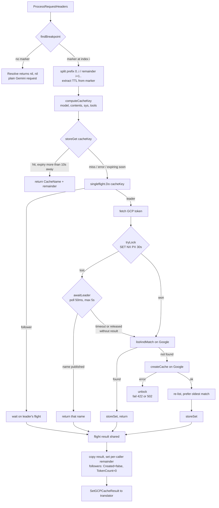
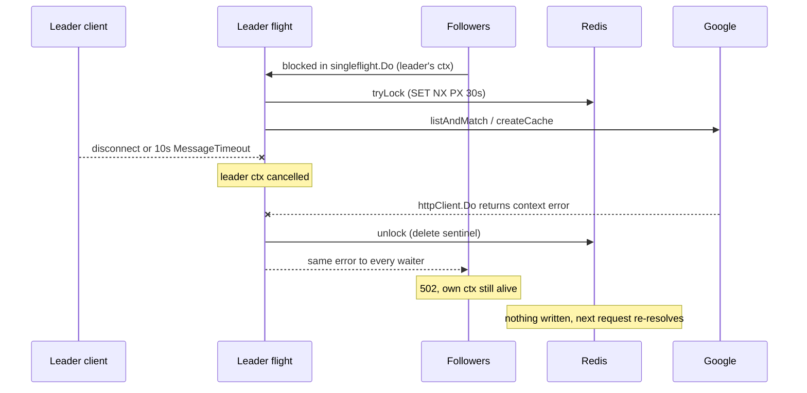

# Gemini Context Caching — Architecture and Request Lifecycle

This document describes what actually happens to a request that carries Anthropic-style
`cache_control` markers when it is routed to a GCP Vertex AI (Gemini) backend, step by step,
and records the caveats and quirks that are not obvious from reading any single file.

It describes the code as built. Where the behavior differs from the original proposal, this
document is authoritative and the difference is called out.

## Components

| Component  | Package               | Role                                                                         |
| ---------- | --------------------- | ---------------------------------------------------------------------------- |
| Processor  | `internal/extproc`    | ext_proc lifecycle; calls the resolver, carries the result to the translator |
| Resolver   | `internal/gcpcache`   | breakpoint detection, cache key, dedup, Google `cachedContents` calls        |
| Store      | `internal/cachestore` | shared key → cache-name mapping; Redis or no-op                              |
| Translator | `internal/translator` | injects the cache name into the Gemini request, attributes tokens            |
| Controller | `internal/controller` | maps the CRD to filterapi, which configures the resolver                     |

The resolver is the only component that talks to Google's `cachedContents` REST API. The
translator never does; it only consumes a resolved name.

## Configuration path

`AIServiceBackend.spec.contextCaching` (both `v1alpha1` and `v1beta1`) →
`internal/controller/gateway.go` → `filterapi.ContextCaching` → `Server.LoadConfig`.

`LoadConfig` keeps a `map[string]gcpcache.CacheResolver` on the server keyed by
`"<backend name>|<redis url>"`. On each filterapi reload it reuses the resolver for an
unchanged backend, builds a new one when the Redis URL changes, and drops entries for
backends that went away. The key includes the URL specifically so that repointing a backend
at a different Redis builds a fresh resolver rather than reusing a connection pool aimed at
the old instance.

The reason resolvers survive reloads is the Redis connection pool, not any in-process cache —
there is no in-process cache. Tearing the resolver down on every filterapi update would
rebuild the pool for no benefit.

## Request lifecycle

### 1. Backend selection — `SetBackend`

`processor_impl.go` type-asserts `backend.CacheResolver.(gcpcache.CacheResolver)`. If the
backend has no resolver, every step below is skipped and the request is a plain Gemini
request.

### 2. `ProcessRequestHeaders` → `Resolve`

Resolution happens at request headers, **before** the body is translated, because the
translator needs the resolved cache name in order to build the Gemini request. This is why
the whole cache resolution — including any Redis wait and up to two Google round-trips —
sits inside the ext_proc request-headers callback, blocking the request.

### 3. Breakpoint detection

`findBreakpoint` scans the message list backwards for the **last** message carrying an
`ephemeral` `cache_control` marker. No marker → `Resolve` returns `(nil, nil)` immediately and
the request proceeds entirely uncached. This is the fast path for the overwhelming majority of
traffic.

### 4. Split

Messages `[0..breakpoint]` become the cached prefix; `[breakpoint+1..]` become the remainder.
Tools and the system instruction always belong to the prefix. The TTL comes from the
breakpoint message's marker (`5m` → `300s`, `1h` → `3600s`, a bare `NNNs` passes through,
anything else falls back to `300s`).

### 5. Cache key

The prefix is converted to Gemini format and hashed: SHA-256 over
`{model, contents, systemInstruction, tools}`, hex-encoded. That digest is used both as the
store key and as the Google `displayName`, which is what makes the Google side idempotent
without any local state.

### 6. Store lookup

`storeGet` reads the key. An entry expiring within `staleThreshold` (10s) is reported as a
**miss** even though it exists, so a request never adopts a cache that may vanish underneath
it. A hit returns immediately — no Google calls at all.

A store _error_ is logged and treated as a miss. It never reaches the caller.

### 7. Singleflight

On a miss, resolution runs inside `singleflight.Group.Do` keyed by the cache key. Leadership
is captured by a `leader` flag set **inside** the closure, not from `Do`'s `shared` return
value — see the quirks section.

### 8. Create lock

Inside the flight: fetch the GCP access token, then `tryLock`. The lock is
`SET key <sentinel> NX PX 30s` in Redis. Winning means proceeding to create. Losing means
polling the key every 50ms for up to `lockWaitTime` (5s) for the leader to publish a real
name; on success the waiter returns that name and stops. On timeout, or if the leader released
without publishing, the waiter **falls through and resolves itself**.

`tryLock` returns false when the store does not implement `cachestore.Locker` at all — which is the
no-op store's case — so an unconfigured deployment simply never coordinates.

### 9. List

`listAndMatch` lists `cachedContents` for the region and project and matches on
`displayName == cacheKey` **and** a model-suffix match. A hit here is written to the store and
returned. This list is the real source of truth; the lock only reduces how often two replicas
both reach the create below.

### 10. Create

No match → `POST` a `CreateCachedContent`. On error the lock is released immediately so
waiters retry rather than blocking for the remainder of the 30s lock TTL.

### 11. Re-list

After a successful create, list again and prefer a different matching name if one appears —
this converges the case where two replicas both created. The store is written with whichever
name won.

### 12. Result handoff

`Resolve` copies the shared result (singleflight hands the _same_ pointer to every waiter),
sets the per-caller `Messages` remainder, and zeroes `Created`/`TokenCount` for followers.
The processor calls `SetGCPCacheResult` with `{CacheName, FilteredMessages, Created,
WriteTokenCount}`.

### 13. Translation

`openai_gcpvertexai.go` validates that markers and an explicit `cachedContent` field are not
both present (422 `ErrMalformedRequest` if they are), swaps in `FilteredMessages`, and injects
`CachedContent` **only if the field is empty** — an explicitly-set vendor field always wins.
It then captures `WriteTokenCount` and nils `pendingCacheResult` so a retry re-resolves.

### 14. Response

`SetCacheCreationInputTokens` is populated on both the non-streaming and streaming paths, so
cache-write cost is attributable exactly once — by the leader only.

## Flow chart



The same flow in ASCII, for contexts where Mermaid does not render:

```
                       ProcessRequestHeaders
                                |
                                v
                    findBreakpoint(messages)
                                |
                +---------------+---------------+
                | no marker                     | marker at index i
                v                               v
        Resolve -> (nil, nil)          split prefix [0..i] / remainder [i+1..]
        plain Gemini request           extract TTL from marker
                                                |
                                                v
                                  computeCacheKey(model, contents, sys, tools)
                                                |
                                                v
                                       storeGet(cacheKey)
                                                |
              +---------------------------------+-----------------------------+
              | hit (expiry > 10s away)          | miss / error / expiring soon
              v                                  v
     return {CacheName, remainder}      singleflight.Do(cacheKey)
                                                 |
                             +-------------------+-------------------+
                             | leader (runs closure)                 | follower (waits)
                             v                                       |
                       fetch GCP token                               |
                             |                                       |
                             v                                       |
                       tryLock(cacheKey)   -- SET NX PX 30s          |
                             |                                       |
                 +-----------+-----------+                           |
                 | won                   | lost                      |
                 |                       v                           |
                 |               awaitLeader (poll 50ms, max 5s)     |
                 |                       |                           |
                 |         +-------------+-------------+             |
                 |         | name published            | timeout /   |
                 |         v                           | released    |
                 |   return that name                  | w/o result  |
                 |                                     v             |
                 +-------------------+-----------------+             |
                                     v                               |
                            listAndMatch (Google)                    |
                                     |                               |
                   +-----------------+-----------------+             |
                   | found                             | not found   |
                   v                                   v             |
             storeSet + return              createCache (Google)     |
                                                       |             |
                                            +----------+---------+   |
                                            | error              | ok|
                                            v                    v   |
                                       unlock, fail 422/502  re-list  |
                                                                 |   |
                                                                 v   |
                                                    prefer oldest match
                                                       storeSet
                                                                 |   |
                                                                 v   v
                                                       flight result shared
                                                                 |
                                                                 v
                                    copy result; set per-caller remainder;
                                    followers: Created=false, TokenCount=0
                                                                 |
                                                                 v
                                              SetGCPCacheResult -> translator
```

## What happens when the leader's request is cancelled

The leader owns the context for the whole flight. Followers are blocked in
`singleflight.Do` on the leader's closure, and that closure was passed the **leader's**
`ctx` — not their own. So a cancellation on the leader propagates outward to everyone
waiting on that key.



Concretely, when the client disconnects or Envoy's 10s `MessageTimeout` fires on the leader:

1. The leader's `ctx` is cancelled.
2. Whichever Google call is in flight (`listAndMatch` or `createCache`) returns a
   context error from `httpClient.Do`.
3. The error path runs: if the leader held the lock, `r.unlock` deletes the sentinel so the
   key is not left claimed for the remaining lock TTL.
4. `resolveUncached` returns the error, the flight completes with that error, and
   `singleflight` hands the **same error** to every follower.
5. Each follower's `Resolve` returns the error. The processor maps it to 502.
6. Nothing is written to the store, so the next request for that key resolves from scratch.

### How long the leader lives

The ceiling is **10 seconds** — Envoy's ext_proc `MessageTimeout`. A client disconnect can end
the flight sooner, but nothing can extend it past that. What the leader spends inside the
budget, in order:

| Step                                     | Worst case                                 |
| ---------------------------------------- | ------------------------------------------ |
| GCP token fetch                          | usually cached in-process, ~0              |
| `tryLock` (Redis)                        | 3s (go-redis read timeout)                 |
| `awaitLeader`, only if the lock was lost | 5s (`lockWaitTime`)                        |
| `listAndMatch` (Google)                  | one round-trip                             |
| `createCache` (Google)                   | the slow step — seconds for a large prefix |
| re-list (Google)                         | one round-trip                             |
| `storeSet` (Redis)                       | 3s (go-redis write timeout)                |

These compose additively and `gcpcache` enforces no total of its own. Only the 10s ext_proc
timeout actually binds — the resolver's own 30s HTTP client timeout can never fire. The worst
path is genuinely over budget: a caller that burns the full 5s lock wait must then fit a token
fetch, list, create, and re-list into the 5s that remain.

### How long the followers wait

Every concurrent request for the **same cache key** blocks in `singleflight.Do` for the whole
life of the flight. The key stays in singleflight's map until the closure returns, so a request
arriving at t=8.9 still attaches — and is released 0.1s later along with everyone else.

A follower's wait is therefore `leader_end - own_arrival`, and all followers are released at the
same instant regardless of when they joined:

```
t=0     leader starts flight; followers begin attaching
t=1     follower A attaches                     -> waits 8s
t=7     follower B attaches                     -> waits 2s
t=9     leader ctx cancelled
t=9     A and B released simultaneously, same error, both 502
```

There is no second leader and no retry inside the flight. `singleflight` does not re-run the
closure or elect a replacement; the flight completes once, with an error, and that result fans
out. "The next request re-resolves" means whatever request happens to arrive next for that key —
a client retry or an unrelated caller — not anything the gateway schedules.

**No follower can time out before the leader does.** Each follower is inside its own
`ProcessRequestHeaders` with its own 10s budget, but every follower arrived _after_ the leader,
so every follower has strictly more budget remaining. They are always released by the leader's
failure while they still have time left. (The Redis `awaitLeader` wait is the exception that
proves the rule: it has its own 5s cap and does give up independently — but that is a _different
replica's_ leader, and on timeout it falls through and resolves itself rather than failing.)

The queue depth is unbounded. Nothing caps how many callers attach to one flight, so the number
that fail together scales with arrival rate × leader duration.

Two consequences worth being explicit about.

**Followers fail even though their own contexts are alive.** A follower whose client is
perfectly healthy gets a 502 because an unrelated request — the one that happened to arrive
first — was cancelled. The blast radius is every concurrent caller of that cache key on that
replica. They recover on retry, but the failure is not theirs.

**Cancellation during create can orphan a Google cache.** If the context dies after Google
has committed the create but before the response is read, the cache exists and nothing local
knows its name. It is not leaked permanently: `displayName` is the deterministic cache key,
so the next request's `listAndMatch` finds and adopts it, and it expires on its own TTL
regardless.

This is accepted rather than fixed. The alternative — detaching the flight from the leader's
context — means a cancelled request keeps doing billable work on Google's side, and it
introduces a flight that no caller can interrupt. The current failure is loud, bounded, and
self-healing on retry; the alternative fails quietly and costs money.

The mitigation, if this ever shows up in practice, is not to change the context ownership but
to shrink the window: `lockWaitTime` at 5s inside a 10s budget is what makes leader
cancellation likely in the first place.

## Error handling

Fail-open is scoped to the **store**. Google failures fail fast, because they are actionable:
a create rejected for being below the model's minimum token count means the markers are
misplaced, and silently serving the request uncached would hide a cost increase.

| Condition                               | Behavior                    |
| --------------------------------------- | --------------------------- |
| Redis unconfigured                      | uncached, 200 OK            |
| Redis unreachable / timeout / bad value | uncached, 200 OK            |
| Google create 422 (below min tokens)    | 422 `cache_creation_failed` |
| Google list/create 5xx or unreachable   | 502 `upstream_error`        |
| GCP auth failure                        | 401 `gcp_auth_error`        |
| markers + explicit `cachedContent`      | 400 `invalid_cache_config`  |

A useful consequence: because store errors are swallowed inside the resolver, a non-nil error
from `Resolve` still unambiguously means a Google failure, so the processor's existing 502
mapping needed no changes.

## Caveats and quirks

**The effective budget is 10 seconds, not 30.** The ext_proc `MessageTimeout` is
`10 * time.Second` (`internal/extensionserver/post_translate_modify.go:453` and `:798`; note
`inferencepool.go:313` uses 300s for a different filter). The resolver's HTTP client defaults
to a 30s timeout, which therefore **can never fire** — Envoy gives up first. Anyone tuning
this should treat 10s as the ceiling.

**None of the timeouts are configurable.** `lockTTL` (30s), `lockWaitTime` (5s),
`lockPollInterval` (50ms) and `staleThreshold` (10s) are package constants; the ext_proc
`MessageTimeout` is hardcoded in the extension server; the go-redis dial/read/write timeouts
are library defaults that are not overridden. The only user-facing knob is the Google cache
TTL, set per-request by the `cache_control` marker or per-backend by
`contextCaching.defaultTTL`. Constants were a deliberate choice — widening the config
surface later is additive, whereas removing a field is a breaking change — but it means
tuning any of the above requires a rebuild.

**`lockWaitTime` spends half the budget.** A follower that polls the full 5s has consumed half
of the 10s ext_proc budget before it even begins its own list+create. The timeouts compose
additively — go-redis (5s dial / 3s read / 3s write, not overridden) + 5s lock wait + Google
round-trips — and `gcpcache` enforces no total of its own. Only the ext_proc timeout binds.

**Both dedup layers are load-bearing.** This was proven by a test failure, not assumed.
Singleflight collapses callers that overlap _in_ time within one replica; the store collapses
callers separated _by_ time and across replicas. Removing the store made a straggler goroutine
— scheduled just after the leader's flight completed — open a second flight and create a
second cache. Neither layer substitutes for the other.

**`shared` cannot identify followers.** `singleflight.Do`'s third return is true for the
leader as well, so it cannot be used to decide who performed the write. Leadership is captured
by setting a flag inside the closure, which only the leader runs. Getting this wrong would
report `Created: true` on every waiter and over-bill the exact cost this feature exists to
reduce.

**The leader owns the context.** If the leader's request is cancelled, the flight fails for
its followers too. They return an error and re-resolve on the next request. This is accepted
rather than fixed: detaching the context would mean a cancelled request keeps doing work.

**The lock narrows the cross-replica race; it does not close it.** If a create outlives the 30s
`lockTTL`, another replica claims the lock and both create. Sizing `lockTTL` above p99 create
duration is tuning, not a guarantee. The re-list step and the deterministic `displayName` are
what make the duplicate converge rather than persist.

**`enabled: true` without `redis` is inert.** The combination is legal and silently does
nothing: the no-op store misses every lookup, discards every write, and never grants a lock.
This is the intended fail-open behavior but is surprising undocumented, which is why the CRD
field carries godoc saying so.

**`aigw` standalone has no caching.** `aigw run` is a single binary with no Kubernetes and no
Redis, so `Redis` is nil and the no-op store applies. This is a real regression against the
earlier in-memory behavior and a direct consequence of removing the in-memory map. If
standalone parity is wanted later, the seam already exists — an in-process `CacheStore`
implementation as the `Redis == nil` default requires no resolver changes.

**A malformed stored value is a miss, not an error.** Decoding failures return a clean miss;
the next write overwrites the bad value. Not worth failing a resolution over.

**Entry encoding puts the name last.** `"<RFC3339 expiry>|<cache name>"` — the cache name is
the only field that can itself contain the separator, so it goes after the single `Cut`.

**Store TTL tracks Google's expiry.** `storeSet` uses `time.Until(e.expireTime)` as the TTL and
skips the write entirely if that is non-positive, so the store cannot outlive what it points at.

## Test coverage map

| Concern                                | Where                                                                              |
| -------------------------------------- | ---------------------------------------------------------------------------------- |
| Store round-trip, sentinel, encoding   | `cachestore/redis_test.go` `TestRedisStore_*`, `TestEncodeDecodeEntry`             |
| Lock exclusivity, unlock, await-leader | `cachestore/redis_test.go` `TestRedisStore_TryLock*`, `_Unlock*`, `_AwaitLeader_*` |
| Store hit skips Google entirely        | `gcpcache_test.go` `TestResolver_StoreHit_SkipsGoogleAPICalls`                     |
| Stale entry re-resolves                | `TestResolver_StoreEntryExpiring_Refetches`                                        |
| In-replica dogpile → one create        | `TestResolver_Dogpile_*`                                                           |
| Cross-replica → one create             | `redis_test.go` `TestResolver_CrossReplica_SingleCreate`                           |
| Redis down → 200 uncached              | `TestResolver_StoreUnreachable_FailsOpen`                                          |
| Google create failure → 422            | `gcpcache_test.go:444`                                                             |
| Resolver error → 502                   | `processor_impl_test.go:2393`                                                      |
| Resolver reload lifecycle              | `server_test.go` `TestServer_LoadConfig_GCPCacheResolver*`                         |

The store's own behavior is tested in `internal/cachestore` against miniredis; the two resolver
tests that need a real store (`TestResolver_CrossReplica_SingleCreate`,
`TestResolver_StoreUnreachable_FailsOpen`) stay in `internal/gcpcache` and import it. The
`memStore` fake there implements `cachestore.Store` but deliberately not `cachestore.Locker`,
which is what covers the uncoordinated fail-open path.
