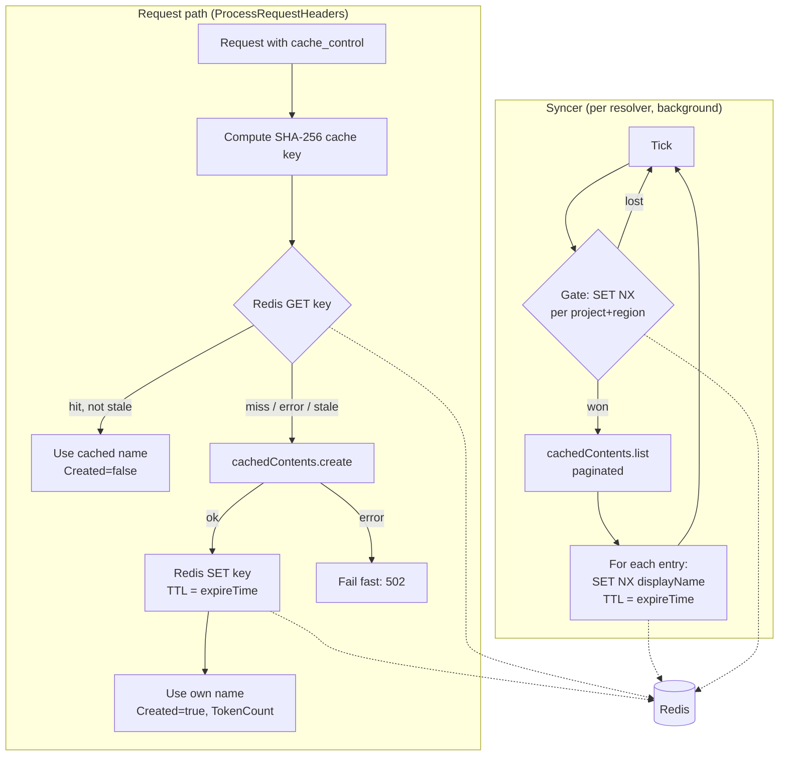
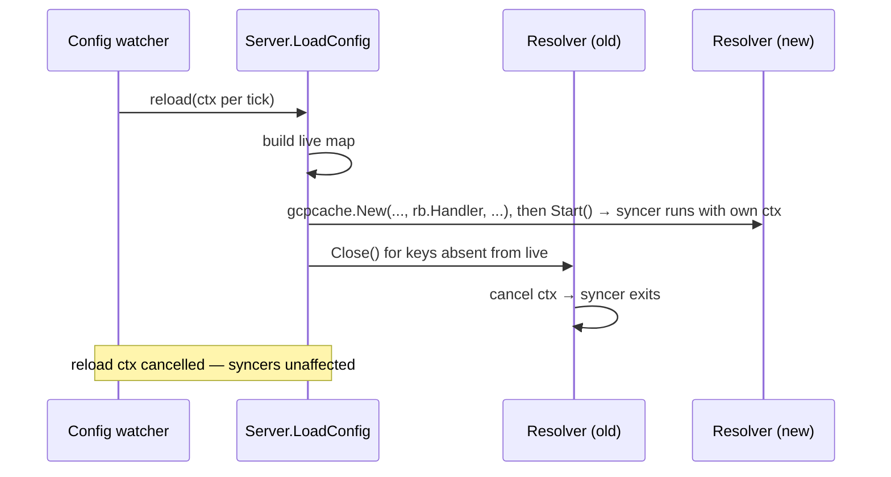

# Specification: Gemini Context Cache — Redis-Only Lookup with Background Syncer

This document is the final design for GCP Vertex AI context-cache deduplication. It
supersedes the "Redis Store and Create Lock" section of
[gemini-cntext-cache-redis.md](./gemini-cntext-cache-redis.md). The alternatives
considered, and why each was rejected, are recorded in
[context-cache-approaches.md](./context-cache-approaches.md) (this design is approach A11).

The Redis amendment's failure policy and resolver reuse across reloads are kept. Its
configuration surface is not: the per-backend `contextCache` CRD field was replaced by
extproc flags (see [Configuration](#configuration)). The store interface is
unchanged in shape but has moved to the provider-neutral `internal/contextcache`
package (see [Package Layout](#package-layout)).

## Table of Contents

<!-- toc -->

- [Context](#context)
- [Technical Architecture](#technical-architecture)
  - [Configuration](#configuration)
  - [Package Layout](#package-layout)
  - [Request Path](#request-path)
  - [Background Syncer](#background-syncer)
  - [Resolver Lifecycle](#resolver-lifecycle)
  - [Store Semantics](#store-semantics)
  - [Failure Policy](#failure-policy)
  - [Metrics](#metrics)
  - [Known Limitations](#known-limitations)
- [Implementation Plan](#implementation-plan)
- [Documentation](#documentation)
- [Success Criteria](#success-criteria)

<!-- /toc -->

## Context

A request carrying `cache_control` markers resolves to a deterministic SHA-256 cache
key. If a Google `cachedContents` entry exists for that key the gateway reuses it;
otherwise it creates one. Creation is billed.

The previous implementation deduplicated creation across replicas with a Redis
`SET NX PX` create lock. The replica that claimed a key created the cache; the others
polled (`awaitLeader`) every 50ms for up to 5s, then fell through to List → Create
themselves. After creating, every replica re-listed and converged onto the oldest match.

That design had four problems:

1. **It is not a guarantee.** Losing the lock does not skip the create. The code states
   this directly: "the duplicate the lock narrows but cannot fully eliminate".
2. **It blocks the request path.** Resolution runs inside `ProcessRequestHeaders`. A
   waiter holds the client request open for up to 5s and issues up to ~100 Redis
   round trips.
3. **Its constants are unjustified.** `lockTTL` (30s) must exceed p99 create latency and
   `lockWaitTime` (5s) must stay under the ext_proc message timeout. Neither was derived
   from measurement.
4. **It hides billed creates.** The converge branch returns `Created: false` and discards
   `TokenCount` even though a create was billed, so cache-write metrics under-count.

The request-path LIST is a second cost. `cachedContents.list` accepts only `parent`,
`pageSize`, and `pageToken` — verified against the Vertex AI discovery document, there is
**no server-side `filter` or `orderBy`**. Matching on `displayName` is therefore a
client-side scan of every cache in the project and region. The old call was also
unpaginated: it never decoded `nextPageToken`, so caches past the first page were
invisible.

**Decision.** Accept duplicate creates as a bounded, billed, visible cost. Remove the
lock and the request-path LIST. Redis alone serves lookups; a background syncer
repairs drift between Redis and GCP off the request path.

## Technical Architecture

### Configuration

Context caching is configured once per gateway, not per backend:

| Helm value | Controller flag | extproc flag |
| --- | --- | --- |
| `extProc.contextCache.storeURL` | `--extProcContextCacheStoreURL` | `-contextCacheStoreURL` |
| `extProc.contextCache.defaultTTL` | `--extProcContextCacheDefaultTTL` | `-contextCacheDefaultTTL` |

- **Store URL:** `host:port` or a `redis://` URL of a Redis-compatible server. Setting it
  enables caching for every GCP Vertex AI (Gemini) backend with GCP credentials; empty
  disables it. There is no per-backend opt-out.
- **Default TTL:** used when a `cache_control` marker gives none. Whole seconds, at least
  60s; default 300s. Validated only when caching is on.
- The controller adds the extproc args only when the store URL is set, and they enter the
  config hash with `omitempty`, so deployments without caching are not restarted on
  upgrade.
- extproc builds one store at startup and shares it across resolvers. A store URL that
  does not parse fails startup.

### Package Layout

Caching is split into a provider-neutral package with two subpackages, so a second
provider only has to supply its API calls.

| Package                          | Owns                                                                                                                                                                                                    |
| -------------------------------- | ------------------------------------------------------------------------------------------------------------------------------------------------------------------------------------------------------- |
| `internal/contextcache`          | Interfaces and shared types only: `Store` (`Get`, `Set`, `SetNX`, `AcquireGate`), `Entry`, `NoopStore`, `CacheResolver`, `ResolveResult`, `CacheSyncer`, `Source`, `StaleThreshold`, and the `Syncer` loop (ticker, gate, `SET NX` writes, `Stats`) |
| `internal/contextcache/redis`    | The Redis `Store`, built with `redis.NewStore(url)`. go-redis is imported as `goredis`                                                                                                                   |
| `internal/contextcache/gcpcache` | `Resolver` (implements `CacheResolver` and `CacheSyncer`), cache key, breakpoint and TTL handling, `createCache`, and a `contextcache.Source` that walks `cachedContents.list`                            |

Keeping the Redis client out of `contextcache` lets `filterapi` import it without
linking go-redis. `filterapi.RuntimeBackend.CacheResolver` is typed as
`contextcache.CacheResolver` (it was `any`, to avoid an import cycle that no longer
exists), so `SetBackend` assigns it without a type assertion. Only `cmd/extproc` links
go-redis; `cmd/controller` does not.

`contextcache.Source` is the seam: `GateKey()` names the scope's gate, and
`List(ctx, add)` reports every gateway-created cache in that scope with its cache key.
The `Syncer` handles everything else.

`NoopStore` implements all four `Store` methods as no-ops. Its `AcquireGate` never wins,
so a syncer over it reports every round as gated and never lists.

Cache keys and the stored value format are unchanged. The gate prefix changed from
`gcpcache:reconcile:` to `gcpcache:sync:`. During a rolling deploy, an old and a new
replica can each win their own gate and list the same scope in the same interval. That
costs extra list calls only: both write with `SET NX`. Old gate keys expire within one
interval after the rollout.

### Request Path

Three steps, with no waiting on other replicas and no LIST:

1. **Lookup.** `GET` the cache key. A hit that is not within `contextcache.StaleThreshold` (10s) of
   expiry is used directly. This is the path taken by nearly all traffic.
2. **Create on miss.** Call `cachedContents.create` with `displayName` set to the key.
3. **Publish.** `SET` the key with its Redis TTL pinned to the returned `expireTime`,
   and return `Created: true` with the returned `TokenCount`.

Replicas racing the same cold prefix each create a cache. Each replica **keeps the cache
it created** and uses that name for its in-flight request. The final Redis value is
last-writer-wins. Both names are valid Google caches, so either outcome is correct.
The replica does not re-read Redis after publishing.

### Background Syncer

The syncer repairs cases where Redis no longer knows about a live Google cache:
flushes, evictions, dropped writes, and caches created before Redis was configured.

On each tick, for its own backend:

1. **Acquire the interval gate.** `SET NX` a gate key scoped to the backend's project and
   region, with the sync interval (60s) as its TTL. A replica that loses the gate skips the
   round. This limits LIST traffic across the fleet without leader election. A missed
   round has no effect on correctness.
2. **Walk the list.** Request `pageSize=1000` (the documented maximum) and follow
   `nextPageToken` until it is empty. There is no page limit and no round deadline (see
   Known Limitations).
3. **Write per-key entries.** For each entry with a parseable `expireTime`, `SET NX` the
   key `displayName` with a TTL pinned to that `expireTime`. `SET NX` means the syncer
   only fills gaps; it never overwrites an entry that a request published.

The syncer never serves requests. If it is late, stuck, or stopped, requests still
succeed; the only effect is more duplicate creates.

Steps 1 and 3 are `contextcache.Syncer`; step 2 is the GCP `Source`. Entries whose
`displayName` is not a cache key were created by another client and are not indexed;
entries within `StaleThreshold` of expiry are not written.

### Resolver Lifecycle

Each GCP backend with context caching configured has one `*gcpcache.Resolver`, and each
resolver owns one syncer goroutine. The resolver scope avoids a race: `LoadConfig` replaces
`s.cacheResolvers` and `s.config` on every reload, and a goroutine owned by one resolver
reads only that resolver's store and credentials.

**Context ownership.** The `ctx` passed to `LoadConfig` belongs to one reload and is
cancelled when the reload finishes (`filterapi/watcher.go` wraps each reload in
`context.WithTimeout(ctx, tick)`). A goroutine started with it would stop within seconds.
The resolver therefore creates its own context with `context.WithCancel` in `Start`.

**Credentials.** `gcpcache.New(httpClient, store, auth, defaultTTL, logger)` takes the backend's
`GCPAuthHandler`, which `LoadConfig` passes from `rb.Handler`. Both `Resolve` and the
syncer use it. With nil credentials the resolver is inert: `Resolve` returns `(nil,
nil)` and `Start` does nothing.

**Interfaces.** `New` returns the concrete `*Resolver`, which implements two interfaces
from `contextcache`:

- `CacheResolver` (`Resolve(ctx, req)`) is what the request path holds. It cannot reach
  `Close`, so request code cannot stop syncing for a shared resolver.
- `CacheSyncer` (`Start()` and `io.Closer`) is the lifecycle. `Start` does nothing if
  the resolver is already running or closed, so reused resolvers are not restarted.

Neither interface mentions GCP: providers bind their credentials at construction.

`extproc.Server` stores `map[string]*gcpcache.Resolver` and calls `Start` and `Close`
directly, with no type assertions.

**Credential changes.** Resolvers are keyed by backend name and reused across reloads.
`LoadConfig` calls `SetAuth` on every reuse, because the controller rotates the access
token; `Resolve` and the syncer read the current credentials under a lock.

**Shutdown.** `Close()` cancels the context and waits for the goroutine to exit; it is
idempotent. After `LoadConfig` builds the new `live` map, it closes every previous
resolver whose key is no longer present. `Server.Close()` closes all resolvers, and
extproc calls it on shutdown after `GracefulStop`.

### Store Semantics

| Writer               | Operation               | TTL                    | Rationale                                  |
| -------------------- | ----------------------- | ---------------------- | ------------------------------------------ |
| Request path         | `SET key entry`         | `until expireTime`     | Publish the replica's own create           |
| Syncer               | `SET NX key entry`      | `until expireTime`     | Fill gaps; never overwrite a request write |
| Syncer gate          | `SET NX gate "1"`       | sync interval (60s)    | Limit LIST calls across the fleet          |

The request path uses `SET`, not `SET NX`, on purpose. `storeGet` treats an entry within
`StaleThreshold` of expiry, or one that does not decode, as a miss while the key still
exists. `SET NX` would refuse to replace it, so every request in that window would create
a billed cache and fail to publish it.

Values are encoded as `"<RFC3339 expiry>|<cache name>"`, as before. The create-lock
sentinel is removed. During a rolling deploy, a leftover `\x00creating` value from an old
replica fails `decodeEntry`, is treated as a miss, and the replica creates a cache. No
migration step is needed.

### Failure Policy

Based on the Redis amendment, corrected to match the code. Every resolver error,
including a rejected create, reaches the client as a 502; there is no 422 path.

| Condition                                               | Behavior                    |
| ------------------------------------------------------- | --------------------------- |
| Store URL unset                                         | caching off, 200 OK         |
| Store URL does not parse, or bad default TTL            | extproc fails to start      |
| Store unreachable / GET or SET error                    | uncached, 200 OK            |
| Syncer LIST or write failure                            | logged at warn, no effect   |
| Create response has missing or unparseable `expireTime` | **502 `upstream_error`** (new) |
| Cache creation rejected (e.g. below minimum tokens)     | 502                         |
| Google `cachedContents` API error / unreachable         | 502 `upstream_error`        |
| GCP token fetch failure in the resolver                 | 502                         |

The new row fixes a silent failure. Today a zero `expireTime` makes `storeSet` compute a
negative TTL and skip the write without logging. Every later request for that prefix then
creates another cache. Without the request-path LIST, nothing would recover from this, so
it must fail visibly.

### Metrics

No new metrics are added. Every create reports `Created: true` and its real
`TokenCount`, which already flows through:

`ResolveResult.TokenCount` → `ContextCacheResult.WriteTokenCount` → `cacheWriteTokens` →
`SetCacheCreationInputTokens` (non-streaming and streaming paths in
`openai_gcpvertexai.go`).

Duplicate creates appear as additional `cache_creation_input_tokens`.

`contextcache.Stats` (`Seen`, `Written`, `Skipped`, `Gated`) is logged at
debug level per round and used by tests. It is not exported as a metric. `Written` is a
direct measure of drift and would be the signal for whether the syncer is worth keeping.

### Known Limitations

These are accepted risks. They have not been seen in practice, and guarding against them
was judged not worth the extra code. Fix them if they show up.

- **No guard against an endless `nextPageToken` chain.** The walk stops only when the API
  returns an empty token, or on shutdown, when `Close` cancels the context used by each
  page request. A server that kept returning new tokens would keep the round running.
- **A slow round can overlap with another replica's round.** The gate TTL is the 60s sync
  interval. If listing a project and region takes longer, the gate expires mid-walk and
  another replica can win it and list the same scope. This costs extra list calls only:
  both write with `SET NX`, so neither overwrites the other.

## Implementation Plan

### Phase 1 — Request path

- [x] Rewrite `resolveUncached` in `gcpcache.go` as token fetch →
      `createCache` → `storeSet` → return `Created: true` with `TokenCount`.
- [x] Delete the `tryLock`/`awaitLeader` block, both `unlock` guards, the `locked` bool,
      the request-path `listAndMatch` call and its match branch, and the post-create
      converge block.
- [x] Delete the `locker` interface and the resolver wrappers `tryLock`, `unlock`, and
      `awaitLeader`.
- [x] In `redis.go`, delete `lockSentinel`, `lockTTL`, `lockWaitTime`,
      `lockPollInterval`, `errLockHeld`, the sentinel check in `Get`, and the
      `tryLock`/`unlock`/`awaitLeader` methods.
- [x] Make `createCache` return an error when `expireTime` is missing or unparseable.
- [x] Confirm nothing references the removed symbols:
      `grep -rn 'tryLock\|awaitLeader\|lockSentinel\|errLockHeld\|lockTTL\|lockWaitTime\|lockPollInterval' internal/ tests/`.

### Phase 2 — Syncer

- [x] Add `SetNX` to the Redis store. (Later folded into `Store`; see Phase 2c.)
- [x] Add the list walk (`cachedContentItem`, `listResponse`, `listPage`) in what is now
      `gcpcache/syncer.go`, changed from "find one match" to "walk and write
      every entry". `modelMatchesSuffix` was not brought back: the cache key already
      includes the model.
- [x] Add pagination: send `pageSize=1000`, decode `nextPageToken`, and stop on an empty
      token. Build the URL with `url.Parse` and set `RawQuery` on a copy, so
      the base URL used by `createCache` stays unchanged. (The original page cap was later
      removed; see Phase 2c.)
- [x] Skip entries with a missing or unparseable `expireTime`, and log a warning.
- [x] Add a per-project/region interval gate using `SET NX` with the interval as TTL.
- [x] Define the sync interval as a package constant (`syncInterval`, 60s).

### Phase 2b — Provider-neutral `contextcache` package

- [x] Create `internal/contextcache` and move `store.go` and `redis.go` into it. (The
      Redis store later moved to `internal/contextcache/redis`; see Phase 2d.)
- [x] Export the store API: `Store`, `Entry{Name, ExpireTime}`, `NoopStore`, and
      `NewRedisStore` (later `redis.NewStore`; see Phase 2d).
- [x] Move `staleThreshold` to `contextcache.StaleThreshold`.
- [x] Move the sync loop (ticker, gate, `SET NX` writes, stats) to
      `contextcache.Syncer`, driven by a `contextcache.Source`.
- [x] Reduce `gcpcache/syncer.go` to a `listSource` over `cachedContents.list`, plus
      `newSyncer` to build one for a backend.
- [x] Keep cache keys and the value format unchanged.
- [x] Move the Redis store tests to `internal/contextcache/redis_test.go` and add
      generic syncer tests with a fake `Source`.
- [x] Switch `internal/extproc/server.go` to the moved Redis store constructor.
- [x] Log syncer failures at warn level and never return them from `Run`.

### Phase 2c — Simplifications and renames

- [x] Fold `ReconcileStore` into `Store`. `NoopStore` gets no-op `SetNX` and
      `AcquireGate`; its gate never wins, so its rounds are gated and never list.
      `newSyncer` no longer type-asserts the store.
- [x] Rename the reconciler to syncer: `contextcache.Reconciler` → `Syncer`,
      `reconciler.go` → `syncer.go` in both packages, `newReconciler` → `newSyncer`,
      `reconcileInterval` → `syncInterval`, `reconcileGatePrefix` → `syncGatePrefix`,
      and logs, comments and tests to match. The Kubernetes controllers' "reconcile"
      naming is unrelated and unchanged.
- [x] Change the gate prefix value to `gcpcache:sync:`.
- [x] Remove the page cap (`listMaxPages`). A round deadline and a repeated-token check
      were tried as replacements, then removed as over-engineering for a failure not yet
      seen. The walk follows `nextPageToken` until it is empty (see Known Limitations).

### Phase 2d — Package layout

- [x] Move `CacheSyncer` to `contextcache` with `Start()` taking no arguments. `gcpcache.New`
      takes the `GCPAuthHandler` instead.
- [x] Move `CacheResolver` and `ResolveResult` to `contextcache` (`resolver.go`).
      `Resolve` becomes `Resolve(ctx, req)` and uses the credentials bound in `New`;
      with nil credentials it returns `(nil, nil)`.
- [x] Remove the request path's per-request `GCPAuthHandler` assertion, and delete
      `Test_upstreamProcessor_GCPCacheResolver_noHandler`. `LoadConfig` only builds
      resolvers for backends whose handler is a `GCPAuthHandler`.
- [x] Move `internal/gcpcache` to `internal/contextcache/gcpcache`.
- [x] Move the Redis store to `internal/contextcache/redis` (`store.go`), rename
      `NewRedisStore` to `NewStore`, and import go-redis as `goredis`.
- [x] Type `filterapi.RuntimeBackend.CacheResolver` as `contextcache.CacheResolver`
      instead of `any`, and drop the type assertion in `SetBackend`.
- [x] Give `contextcache`'s own syncer tests an in-memory `memStore`, since importing
      the `redis` package from them would be a cycle.

### Phase 2e — Gateway-wide configuration

- [x] Remove `contextCache` from `AIServiceBackend` (both versions) and
      `filterapi.Backend`, and the controller code that copied it. Regenerate deepcopy,
      CRD YAML and `api.mdx`.
- [x] Add extproc flags `-contextCacheStoreURL` and `-contextCacheDefaultTTL` (validated:
      whole seconds, at least 60s, only when caching is on).
- [x] Add controller flags `--extProcContextCacheStoreURL` and
      `--extProcContextCacheDefaultTTL`, pass them to extproc only when the URL is set,
      and include them in the config hash with `omitempty`.
- [x] Add Helm values `extProc.contextCache.storeURL` and `defaultTTL`.
- [x] Build one store at extproc startup (`Server.EnableContextCache`); key resolvers by
      backend name; attach them only to `GCPVertexAI` backends.
- [x] Pass the default TTL to `gcpcache.New`. This fixes the old CRD `defaultTTL`, which
      was never read.
- [x] Remove the `crdcel` context-cache fixtures and the controller `ContextCache`
      mapping tests; add flag, arg and config-hash tests.

### Phase 3 — Lifecycle

- [x] Add `Start` on the resolver. It creates a resolver-owned context with
      `context.WithCancel`, builds the syncer with `newSyncer`, and runs `Syncer.Run`.
- [x] Export the resolver as `gcpcache.Resolver` and have `New` return `*Resolver`.
      Group `Start` and `Close` under a `CacheSyncer` interface. (An earlier
      `Background` interface reached through type assertions was removed.)
- [x] `LoadConfig` passes `rb.Handler` to `gcpcache.New` and calls `Start()`. `Start`
      does nothing if the resolver is already running, so resolvers reused across
      reloads are not restarted.
- [x] Implement `Close()` so it cancels the context and waits for the goroutine. Make
      it idempotent.
- [x] In `internal/extproc/server.go`, store `map[string]*gcpcache.Resolver`. After
      building `live`, `LoadConfig` calls `Close()` directly on every previous resolver
      whose key is absent from `live`.
- [x] Keep `CacheResolver` free of lifecycle methods, so the request path cannot call
      `Close`.
- [x] Also call `Server.Close()` on extproc shutdown, after `GracefulStop`, so
      syncers exit before the process does.

### Phase 4 — Tests

- [x] Delete the seven lock unit tests in `redis_test.go`.
- [x] Split `TestResolver_CrossReplica_SingleCreate` into:
  - [x] `TestResolver_CrossReplica_SecondResolveHitsStore` — sequential resolves on a
        shared miniredis: one create, second result `Created: false`, and no further
        Google calls.
  - [x] `TestResolver_CrossReplica_ColdPrefixRaceMayDuplicate` — concurrent resolves:
        two creates, both `Created: true` with non-zero `TokenCount`, and each result
        uses the name returned by its own create.
- [x] Rewrite `TestResolver_DuplicateCreateRace_UsesListResult` as
      `TestResolver_DuplicateCreateRace_KeepsOwnCreate`, asserting the replica's own name,
      `Created: true`, and `lists() == 0`.
- [x] Add `TestResolver_RequestPath_NeverLists`.
- [x] Add `TestResolver_CreateExpiryUnparseable_Fails`.
- [x] Add syncer tests:
  - [x] A multi-page walk writes every entry.
  - [x] `SET NX` does not overwrite an existing entry.
  - [x] A `NoopStore` round is gated and makes no list call.
  - [x] The interval gate makes a second replica skip the round.
  - [x] A LIST failure is logged and not returned.
  - [x] Entries with an unparseable `expireTime` are skipped.
- [x] Add lifecycle tests:
  - [x] `Close()` stops the syncer goroutine (check with `goleak` or context
        cancellation).
  - [x] `LoadConfig` closes resolvers for removed backends and keeps resolvers for
        unchanged backends.
- [x] Remove the `locker` reference from the `memStore` comment in `gcpcache_test.go`.

### Phase 5 — Verification

- [x] `go test ./internal/contextcache/... ./internal/extproc/... ./internal/filterapi/... -race -count=3`
- [x] Race tests repeated with `-race -count=5`.
- [x] `go test ./internal/translator/... -count=1`
- [x] `make test`
- [x] `make precommit` (includes `make lint`)
- [x] `make test-data-plane`: not applicable. `tests/data-plane` has a Gemini
      `generateContent` case but no backend with `contextCache`, so it does not exercise
      context caching. Adding a data-plane case with a fake `cachedContents` server is
      open follow-up work.

## Documentation

### Code comments and proposals

- [x] Rewrite the `gcpcache` package doc, which currently names the create lock as the
      deduplication mechanism.
- [x] Rewrite the `resolveUncached` doc comment and the inline comment in `Resolve`.
- [x] Rewrite the `resolver.store` field comment.
- [x] Rewrite the `CacheStore` interface doc in `store.go`: the store is a shared cache,
      not a lock.
- [x] Remove the create-arbitration paragraph from the `redisStore` type doc.
- [x] Add a doc comment to `contextcache.Syncer` covering the gate, `SET NX`, and the fact that the syncer never serves requests.
- [x] Remove `ContextCacheSpec` from both API versions and `filterapi.ContextCache`
      (configuration moved to extproc flags), and regenerate `site/docs/api/api.mdx` and
      the CRD YAML.
- [ ] Add a note to `gemini-cntext-cache-redis.md` that its "Redis Store and Create Lock"
      section is superseded by this document.
- [ ] Search for other stale references:
      `grep -rin 'create lock\|lockSentinel\|awaitLeader' --include='*.md' .`
- [ ] In the PR description, state the trade-offs: more cold-prefix creates, lower
      worst-case latency, the rolling-deploy behavior for leftover sentinel values and
      the changed gate prefix, and the accepted pagination risks (see Known Limitations).

### Site docs (`site/docs`)

Current state: no user-facing page documents Gemini context caching.
`capabilities/llm-integrations/prompt-caching.md` covers only Claude on Anthropic,
Vertex AI, and Bedrock. It says "No gateway-side configuration is needed", which is
wrong for Gemini, because Gemini caching requires the operator to set a context-cache
store URL on the gateway (Helm `extProc.contextCache.storeURL`). No user-facing page
documents it yet.

Follow `site/AGENTS.md`: check every field name and default against `api/` and
`internal/`, use relative links, and do not edit `versioned_docs/`.

- [ ] **`capabilities/llm-integrations/prompt-caching.md`**
  - [ ] Add a row for GCP Vertex AI (Gemini) to the Supported Providers table, with API
        schema `GCPVertexAI` and cache support "Gateway-managed (requires Redis)".
  - [ ] Change "No gateway-side configuration is needed" so it applies only to the
        Claude providers.
  - [ ] Add a "Gemini Context Caching" section that covers:
    - [ ] How it works: the gateway finds the last `cache_control` breakpoint, creates a
          Vertex AI `cachedContents` entry for the prefix, and sends only the remaining
          messages with the cache name.
    - [ ] Only the **last** breakpoint is used. This differs from the "up to 4 cache
          breakpoints" behavior described for Claude.
    - [ ] TTL: the `cache_control` `ttl` values `5m` and `1h`, and the gateway-wide
          `extProc.contextCache.defaultTTL` (default `300s`, minimum `60s`).
    - [ ] A Helm values example with `extProc.contextCache.storeURL` and `defaultTTL`,
          checked against `manifests/charts/ai-gateway-helm/values.yaml`. Note that it
          applies to every GCP Vertex AI backend.
    - [ ] A Redis-compatible store is required. If it is unreachable, requests are sent
          uncached and do not fail.
    - [ ] Replicas that receive the same new prefix at the same time may each create a
          cache, and each create is billed. Say that this shows up as
          `cache_creation_input_tokens`.
    - [ ] Errors: a failed create (for example, a prefix under the model's minimum token
          count) returns 502. Explain that this usually means the breakpoint is in the
          wrong place.
  - [ ] Fix the "All providers: Minimum 1,024 tokens" notes. Gemini's minimum depends
        on the model, so link to Google's documentation instead of stating a number.
  - [ ] Add a Gemini note to the Provider-Specific Notes list.
- [ ] **`getting-started/connect-providers/gcp-vertexai.md`**
  - [ ] Add a short "Context Caching (Gemini)" section after "Configuring More Models"
        with the minimal Helm values snippet and a link to the prompt caching page.
  - [ ] Add the 502 on a failed cache create to the Troubleshooting list.
- [ ] **`capabilities/index.md` and `capabilities/llm-integrations/index.md`**
  - [ ] Update the Prompt Caching summary line so it also covers Gemini context
        caching.
- [ ] **`api/api.mdx`**
  - [ ] Do not edit by hand. Regenerate it with `make apigen codegen apidoc` after the
        CRD godoc changes above, and commit the output.
- [ ] **`examples/cache/cache_control.md`** (outside `site/`, linked from the prompt
      caching page)
  - [ ] Add a Gemini example with the backend config and a curl request, or remove the
        link if the example stays Claude-only.
- [ ] **Verify the site**
  - [ ] Run `npm run build` in `site/` to catch broken links and MDX errors.
  - [ ] Run `npm run check:brand` in `site/`.
  - [ ] Make sure new prose uses the current product name (Agent Router), and that
        frozen identifiers such as `aigateway.envoyproxy.io` and `AIServiceBackend`
        stay unchanged.

## Success Criteria

1. **No request-path waiting.** A request never waits on another replica. Cold-prefix
   resolution takes one create call and one Redis `SET`.
2. **No request-path LIST.** `cachedContents.list` is called only by the syncer.
3. **Warm prefixes use the store.** After any replica publishes a key, other replicas
   reuse it with no Google calls.
4. **Duplicate creates are visible.** Every create reports `Created: true` and its real
   `TokenCount`. Concurrent cold-prefix creates show up as extra
   `cache_creation_input_tokens`.
5. **Each replica keeps its own create.** During a race, a replica uses the cache it
   created and does not switch to another replica's cache.
6. **The syncer repairs drift.** After Redis is flushed, the next sync round restores
   entries for live Google caches without overwriting newer request writes.
7. **The syncer is optional for correctness.** If syncing fails, times out, or stops,
   requests still succeed.
8. **Syncers shut down cleanly.** Removing or repointing a backend stops its syncer
   goroutine, and no goroutines leak across reloads.
9. **Invalid expiry is reported.** A create response with a missing or unparseable
   `expireTime` returns an error instead of silently skipping the store write.
10. **Failure policy is preserved.** Redis failures still leave the request uncached with
    200 OK. GCP-side failures return 502.
11. **Lock code is removed.** No lock symbols, sentinel handling, or lock tests remain.
12. **CI passes.** `make precommit test` and `make lint` pass, and `test-data-plane`
    passes where it applies.
