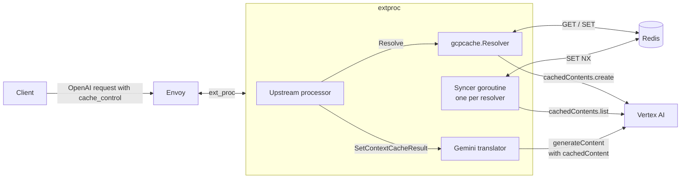
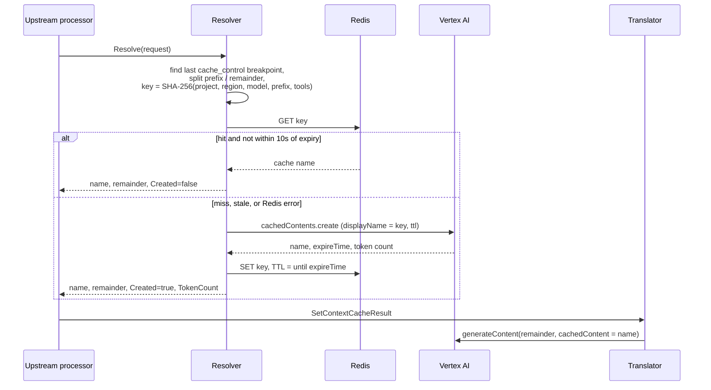
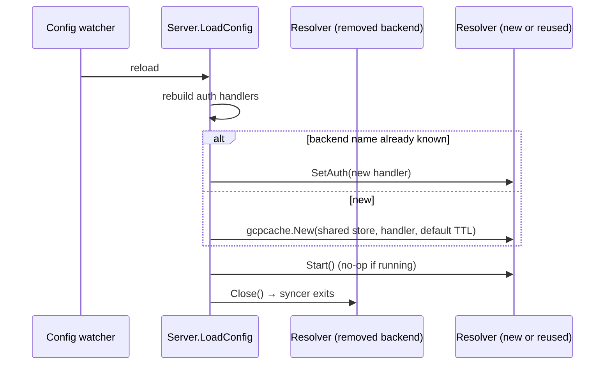

**PR title:** `feat: gateway-managed context caching for GCP Vertex AI Gemini`

**Description**

This commit adds context caching for GCP Vertex AI (Gemini) backends. Clients mark a
prefix of the conversation with Anthropic-style `cache_control` markers, as they already
can for Claude. The gateway creates a Vertex AI `cachedContents` entry for that prefix,
reuses it on later requests, and sends Gemini only the messages after the prefix.

Unlike Anthropic, Vertex AI does not cache implicitly from markers: a cache is a separate
resource that must be created, named, and referenced. The gateway does that work and
records which cache each prefix maps to in a shared Redis, so every replica can reuse a
cache that any replica created.

### Configuration

Context caching is configured once per gateway, not per backend. Helm values:

```yaml
extProc:
  contextCache:
    storeURL: redis.default.svc.cluster.local:6379 # empty disables caching
    defaultTTL: 300s                               # TTL when a marker gives none; >= 60s
```

These become controller flags (`--extProcContextCacheStoreURL`,
`--extProcContextCacheDefaultTTL`), which the controller passes to every extproc as
`-contextCacheStoreURL` and `-contextCacheDefaultTTL`. The store URL is `host:port` or a
`redis://` URL of a Redis-compatible server.

Setting the store URL turns caching on for every GCP Vertex AI (Gemini) backend; leaving
it empty turns it off. There is no per-backend opt-out. The args are only added when the
URL is set, so existing deployments keep the same extproc args and are not restarted on
upgrade. Requests without `cache_control` markers are unaffected.

### Architecture



### Request path



The request path never waits on another replica and never lists caches. A cache write is
reported as `cache_creation_input_tokens` only on the request that created it.

### Background syncer

Redis can lose entries for caches that still exist in GCP: a flush, an eviction, or a
dropped write. Each resolver runs a syncer that repairs this off the request path. Every
60 seconds it:

1. Takes a fleet-wide gate with `SET NX gcpcache:sync:<project>/<region>`, TTL 60s, so
   one replica lists each project and region per interval. A replica that loses the gate
   skips the round.
2. Walks `cachedContents.list` (`pageSize=1000`, following `nextPageToken`). The API has
   no server-side filter, so every cache in the project and region is read.
3. Writes each gateway-created entry with `SET NX`, so it only fills gaps and never
   overwrites a name a request just published.

The syncer never serves requests. If it fails, requests still work and simply create
more caches.

### Lifecycle across config reloads



extproc builds one store at startup, shared by all resolvers. Resolvers are keyed by
backend name and reused across reloads, so their syncers keep running. A reused resolver
receives the new auth handler, because the controller rotates the GCP access token. A
resolver whose backend was removed or is no longer GCP Vertex AI is closed. `Server.Close()` stops all
syncers on shutdown.

### Failure behavior

| Condition | Result |
| --- | --- |
| Redis unreachable, or GET/SET fails | Logged; request served uncached (200) |
| Store URL does not parse | extproc fails to start |
| Default TTL below 60s or not whole seconds (with caching on) | extproc fails to start |
| Syncer list or write fails | Logged; next round retries |
| `cachedContents.create` fails (e.g. prefix below the model's minimum token count) | 502 |
| Create response has no `expireTime` | 502, rather than silently never storing the entry |

Redis failures fail open because caching is an optimization. GCP failures fail fast
because they usually mean the markers are misplaced, and serving the request uncached
would hide a cost increase.

### Code layout

| Package | Contents |
| --- | --- |
| `internal/contextcache` | Provider-neutral interfaces and types: `Store`, `Entry`, `NoopStore`, `CacheResolver`, `ResolveResult`, `CacheSyncer`, `Source`, and the `Syncer` loop |
| `internal/contextcache/redis` | Redis `Store` (`redis.NewStore`) |
| `internal/contextcache/gcpcache` | GCP `Resolver`: breakpoint and TTL handling, cache key, `cachedContents.create`, and the `cachedContents.list` source for the syncer |
| `internal/translator` | Optional `ContextCacheSetter` interface, implemented by the Gemini translator |
| `internal/extproc` | Resolver lifecycle in `LoadConfig`, resolution in the upstream processor |

`contextcache` holds no Redis client, so `filterapi` can reference
`contextcache.CacheResolver` without linking go-redis into the controller. A second
provider would add a package beside `gcpcache` and reuse the store and syncer.

New dependencies: `github.com/redis/go-redis/v9`, and `github.com/alicebob/miniredis/v2`
for tests.

**Related Issues/PRs (if applicable)**


**Special notes for reviewers (if applicable)**

- **Duplicate creates are accepted by design.** Replicas that miss the same new prefix at
  the same moment each create a cache. Each keeps the one it created, and each create is
  billed and shows up in `cache_creation_input_tokens`. A Redis create lock was tried and
  removed: it blocked requests inside `ProcessRequestHeaders` for up to 5s and still could
  not guarantee a single create. The alternatives considered are written up in
  `docs/proposals/008-gemini-context-caching/context-cache-approaches.md`.
- **The cache key includes GCP project and region**, because a `cachedContents` name only
  works in its own location and backends may share a Redis. It is computed over JSON with
  sorted map keys (`internal/json.MarshalSorted`); with sonic's default unsorted maps,
  tool schemas and function call args gave the same prefix a different key per request.
- **Fix to existing GCP auth (`internal/backendauth/gcp.go`).** The ADC token source was
  built on the config-load context. `oauth2.TokenSource.Token()` takes no context, so
  every later refresh used it, and the config watcher cancels that context as soon as
  each reload returns. After any reload (or a first load retried on a tick), every token
  fetch failed with `context canceled`, on the request path as well as the syncer. The
  token source now uses `context.Background()` carrying the proxy HTTP client. This bug
  is also in `main` and could be split into its own PR.
- **Debug logging:** cache hit, miss and create are logged by the resolver, and the
  rewritten Gemini request body by the processor (redacted when `enableRedaction` is set).
- **Known limitations, accepted for now:**
  - The sync walk has no page limit or deadline. A pagination chain that never ends would
    keep a round running until shutdown, and a round longer than 60s can overlap another
    replica's round (extra list calls only; writes use `SET NX`).
  - If the attempt that created a cache then fails upstream and is retried, the retry
    reuses the cache and reports no write, so that write may be missing from
    `cache_creation_input_tokens`. Not yet verified against the error path.
  - Caching is on for every Gemini backend once the store URL is set; there is no
    per-backend opt-out.
  - The store URL is passed as a container arg, so a `redis://` URL with credentials is
    visible in the extproc pod spec. A Secret-backed option is not included.
  - `aigw run` does not pass the context-cache flags, so caching is off there.
  - Markers are only detected on tool messages, list-form system messages, and user
    text, image and audio parts. Markers on assistant messages or plain-string system
    messages are ignored, and markers are silently ignored when caching is off.
  - Cache keys change for prefixes containing maps (sorted encoding), so those prefixes
    miss once after deploy.
- **Not in this PR:** user-facing pages under `site/docs` (the prompt-caching page still
  says no gateway-side configuration is needed, which is wrong for Gemini), and a
  `tests/data-plane` case with a fake `cachedContents` server. Only the generated
  `site/docs/api/api.mdx` is updated here.
- **No regression test for the auth fix yet.** It needs fake `authorized_user` ADC
  credentials against a fake token endpoint; service-account keys do not reproduce it.
- **Testing:** unit tests across `contextcache`, `gcpcache` (including cross-replica
  races on miniredis), `redis`, `translator` and `extproc` (including `goleak` checks for
  syncer shutdown), plus flag validation in `cmd/extproc/mainlib` and arg and config-hash coverage in
  the controller's extproc builder. `make test`, `make test-crdcel`, `make test-controller` and `make precommit` pass.
